# CustomJobSeek architecture

> Last verified against commit `124be66` on 14 October 2026.
>
> This document describes the code as it exists. `docs/handoff.md` explains how
> to rebuild, operate, deploy, and continue the project from another computer.

## 1. System at a glance

CustomJobSeek is a deterministic job-search product. It does not call an LLM in
its production workflows. A user supplies a factual career profile; code scores
jobs, chooses only lines already present in that profile, builds application
documents, and tracks the application.

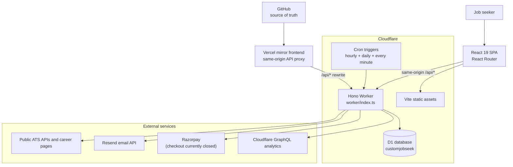

The primary production runtime is one Cloudflare Worker. The Worker serves both
the SPA and `/api/*`, which keeps session cookies first-party. Vercel can serve
the same built SPA and rewrites `/api/*` to the Worker. Do not split the API
across hosts without revisiting cookie and CSRF assumptions.

## 2. Repository map

```text
src/                  React application
  components/         Shared UI, job drawer, scan dialog, resume viewer
  pages/              Route-level screens
  api.ts              Typed browser API client and capacity events
  session.tsx          Signed-in account and pause state
  data.tsx             Jobs, profile, and search-path state

worker/               Cloudflare Worker
  index.ts             Hono app, middleware, routes, cron dispatcher
  routes/              HTTP route modules
  scan.ts              Employer-board crawl
  autoScan.ts          User market-scan queue and pack generation
  openingsSync.ts      Opening delta planning and writes
  pipelineLiveness.ts  Rechecks saved job links
  crypto.ts            Password hashing and AES-GCM helpers

shared/               Code used by browser, Worker, and tests
  engine/              Fit, tailoring, documents, matching, search paths
  types.ts             Main domain types
  plans.ts             Prices and credit grants
  capacity.ts          Crawl/write budgets and quota constants
  dbCapacity.ts        Friendly database-pause model

migrations/           Ordered D1 migrations, 0001 through 0018
tests/                Vitest unit and Worker/D1 integration tests
scripts/              Seed/import/maintenance scripts
docs/                 Architecture, handoff, and operations
wrangler.jsonc        Worker, D1, variables, assets, and cron configuration
vercel.json           Vercel SPA fallback and API proxy
```

## 3. Runtime topology

### Cloudflare

- Worker entry point: `worker/index.ts`
- D1 binding: `DB`
- Static assets: Vite output, SPA fallback enabled
- Worker runs first for `/api/*`
- Observability is enabled
- Production secrets are stored with Wrangler and never committed

### Vercel

`vercel.json` has two rewrites:

1. `/api/(.*)` to `https://customjobseek.fkhambaty.workers.dev/api/$1`
2. every other path to `/index.html`

Vite skips the Cloudflare plugin when `VERCEL=1`. Cloudflare remains the API and
database authority.

### Request lifecycle

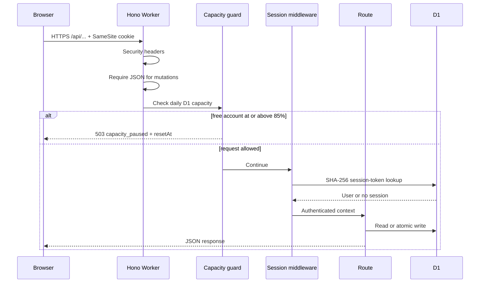

Global API protections:

- `secureHeaders()` on all routes.
- Mutations must be JSON, except PDF upload, Razorpay webhook, and mail
  unsubscribe endpoints.
- Capacity middleware runs before route handlers.
- Expected errors become JSON. Unexpected errors return an opaque reference,
  not internal details.

Routes are mounted from:

| Prefix | Responsibility |
|---|---|
| `/api/auth` | Signup, verification, login, logout, reset, account deletion |
| `/api/onboarding` | Guided setup progress |
| `/api/profile` | Encrypted profile and resume import |
| `/api/jobs` | Fit checks, pipeline records, documents, events, contacts |
| `/api/search-paths` | Up to six ordered location/pay paths |
| `/api/companies` | Public employer catalog and missed-board reports |
| `/api/discover` | Market scans, candidates, schedule, scan status |
| `/api/resumes` | Resume library and stored file artifacts |
| `/api/account` | Preferences and data export |
| `/api/support` | Support requests |
| `/api/workspace` | Company threads and audit-style workspace data |
| `/api/mail` | Unsubscribe |
| `/api/billing`, `/api/checkout` | Plans, Razorpay orders, recovery, webhook |
| `/api/plans` | Public plan catalog |

## 4. Frontend architecture

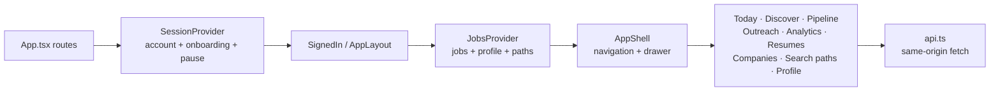

### Session state

`src/session.tsx` calls `/api/auth/me` on startup and stores:

- the signed-in account,
- the persisted onboarding step,
- loading state,
- a capacity pause.

`src/api.ts` recognizes a structured capacity response, converts reset time to
the browser's local time, and dispatches a browser event. This allows a login
attempt, an already-open page, and signed-out routing to show the same friendly
pause UI.

### Shared signed-in state

`src/data.tsx` loads jobs, profile, and search paths in parallel. It offers
`put`, `drop`, and `reload` so a job drawer update appears across Today,
Pipeline, Analytics, and other screens without a full reload.

The client follows paginated job responses until no cursor remains or 4,000
jobs have been loaded. The cap protects the browser; it does not delete data.

### Main routes

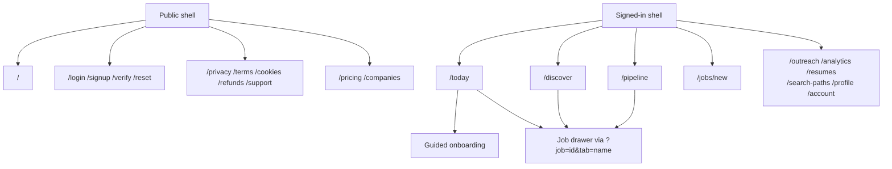

The job drawer's tabs are overview, resume, application, job description,
people/messages, and history. Escape closes the drawer. A standalone job route
also exists for direct navigation.

## 5. Core domain and database

Migrations must be applied in numeric order. Never edit an already-applied
migration; add the next numbered file.

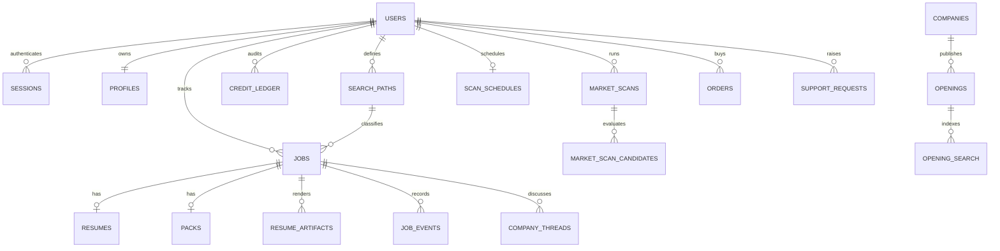

### User-owned data

- `users`: identity, plan, three wallets, verification, scan locks.
- `sessions`: hashed session token and expiry.
- `profiles`: AES-GCM encrypted JSON profile.
- `jobs`: searchable/sortable public fields plus encrypted private details.
- `resumes`: encrypted structured tailored resume.
- `packs`: encrypted application and job-description documents.
- `resume_artifacts`: encrypted HTML and PDF bytes.
- `resume_uploads`: encrypted text extracted from an uploaded PDF.
- `job_events`: dated status and history entries.
- `company_threads`, `thread_messages`: outreach workspace.
- `search_paths`: ordered city/remote and pay rules.
- `credit_ledger`: append-only wallet audit.
- `market_scans`, candidates, schedules, and logs.

### Shared catalog

- `companies`: employer and board-adapter state.
- `openings`: current and expired openings with canonical identity.
- `opening_search`: normalized token index for title matching.
- `source_adapters`: adapter capabilities and health.
- `missed_reports`: user-submitted gaps in coverage.

### Commercial and operational data

- `orders`, `payment_events`, `entitlements`.
- `referral_intents`, referral records and awards.
- `consent_preferences`, `product_events`.
- `support_requests`, `rate_limits`, `email_codes`.
- `quota_samples`, `owner_alerts`, `lifecycle_sends`.
- `batch_guards`: deliberate constraint failures used to make D1 batches
  conditional and atomic.

### Encryption boundary

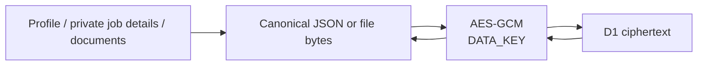

`DATA_KEY` is a base64-encoded 32-byte key. Losing it makes existing encrypted
profiles and documents unreadable. Rotating it requires a migration that
decrypts with the old key and encrypts with the new key.

## 6. Authentication and security

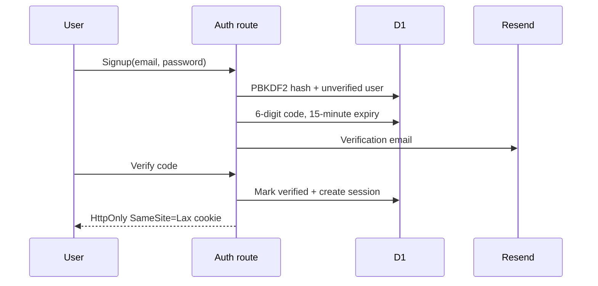

- Passwords: PBKDF2-SHA256, 100,000 iterations, random salt.
- Sessions: random bearer value; only its SHA-256 digest is stored.
- Session cookie: `HttpOnly`, `SameSite=Lax`, `Secure` on HTTPS, 30 days.
- Verification/reset codes: short-lived and attempt-limited.
- Reset revokes every existing session for the account.
- Rate limits are stored in D1 using hashed buckets.
- Account export is rate-limited.
- Account deletion explicitly removes user-owned rows.
- Raw support messages and email addresses are not included in owner-alert mail.

If Resend is not configured, local development logs what would have been sent.
Production signup cannot be completed without a working email provider.

## 7. Deterministic fit and document engine

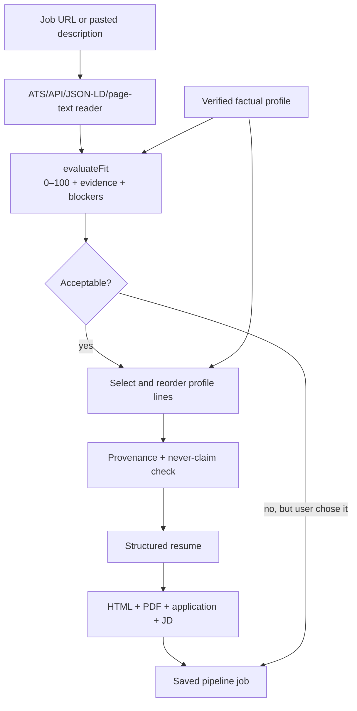

Important invariants:

1. The system does not invent achievements, employers, tools, dates, or skills.
2. Resume bullets must trace to a profile bullet identifier and text.
3. Never-claim tools cannot appear in generated documents.
4. Pay is compared only when currencies match.
5. Missing salary is never guessed.
6. Rebuilding a resume for the same job is free.
7. A new fit check and a first resume each use their own wallet.
8. A scan is charged only when at least one application pack is saved.

Relevant modules:

| Stage | Code |
|---|---|
| Posting fetch | `worker/jobFetch.ts` |
| Fit | `shared/engine/fit.ts` |
| Classification | `shared/engine/classify.ts` |
| Tailoring and provenance | `shared/engine/tailor.ts` |
| Application/JD files | `shared/engine/documents.ts` |
| Outreach text | `shared/engine/outreach.ts` |
| Resume HTML/PDF | `shared/resumeHtml.ts`, `shared/resumePdf.ts` |
| Atomic fit charge | `worker/jobCharge.ts` |
| Atomic resume charge | `worker/resumeCharge.ts` |
| Stored artifacts | `worker/resumeArtifacts.ts` |

PDF and HTML payloads must remain below D1's value-size limit. Storage guards
return a clear error instead of attempting an oversized write.

## 8. Employer-board crawl

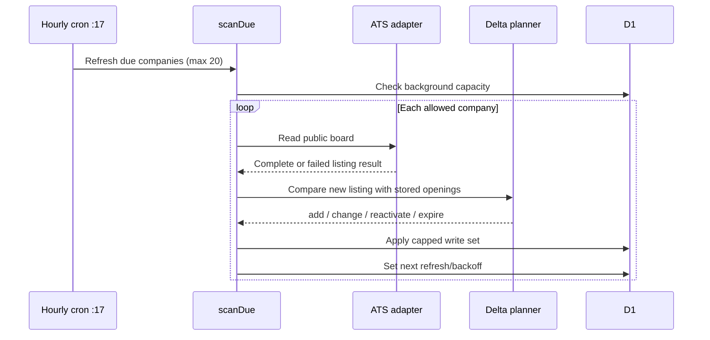

Rules that prevent destructive sync:

- A failed or visibly truncated board read must not expire openings.
- Unchanged openings are not rewritten.
- Missing openings are marked expired, not deleted.
- Reactivated openings preserve first-seen history.
- Writes are capped per pass.
- Deferred writes cause an earlier follow-up refresh.
- Background work stops around 50% of the daily D1 allowance.

Refresh bands start at two, six, twelve, or twenty-four hours according to
company priority. Quiet or failing boards back off, up to one week.

Supported adapters and their exact capabilities live in
`shared/engine/sourceCatalog.ts`, `shared/engine/boards.ts`, and
`worker/adapters.ts`. Do not claim a site has full-description support merely
because its list endpoint works.

## 9. User market scan

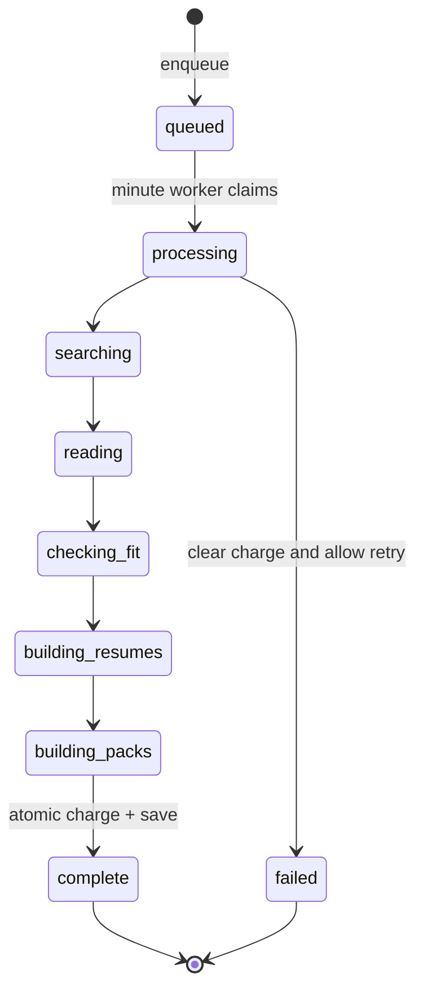

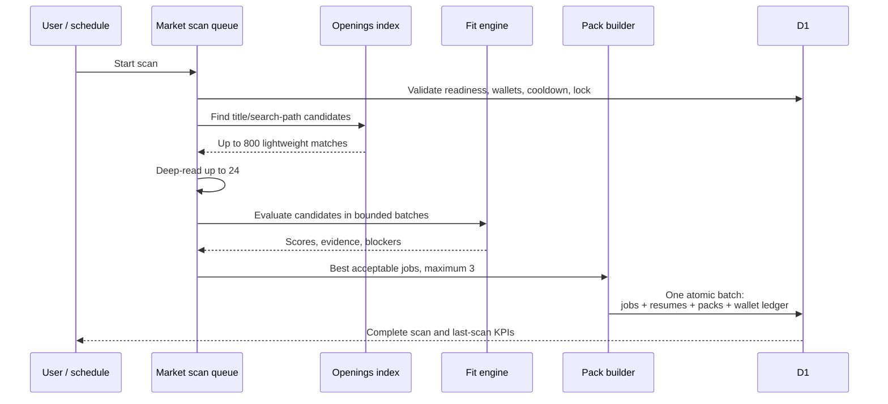

Key limits:

- maximum three prepared packs per scan,
- maximum 24 deep reads,
- six-hour wait between manual scans,
- one scan lock per user,
- two queued scans processed per minute tick,
- scheduled scans are for paid plans,
- scheduled scan dispatcher starts at most ten users per tick.

Search paths influence acceptance and classification. A path is one city or
Remote plus above, below, or any published pay. The published range midpoint is
used. Currency must match. Missing pay remains visible for human review.

## 10. Pipeline liveness

Saved job URLs are rechecked during scan work. A generic closed-page signal must
appear twice before the system auto-closes an early-stage job. Applied,
interviewing, and offer-stage jobs are not auto-closed merely because a public
page changed. The previous status is retained so the auto-close can be reversed.

Files:

- `worker/pipelineLiveness.ts`
- `shared/engine/liveness.ts`
- migrations `0015` and `0016`

## 11. Credits, plans, and billing

There are three wallets:

| Wallet | Spent by |
|---|---|
| `eval_credits` | First fit check for a new job |
| `resume_credits` | First tailored resume for that job |
| `scan_runs` | A scan that successfully creates one or more packs |

A successful market scan also spends one fit and one resume credit for each pack
it creates. Charges and resulting records share an atomic D1 batch and a charge
token, so a retry cannot double-charge.

Plans and prices are defined only in `shared/plans.ts`. Do not duplicate price
logic elsewhere. Purchased credits currently expire after 180 days.

Razorpay integration exists, but checkout is intentionally closed while
`PAYMENTS_ENABLED` is `"false"`. A browser return page never grants credits by
itself. Credits are granted only after a valid signed webhook or server-side
verification of a captured order with the expected amount.

Refund integrity rules:

- reverse only unused purchased credits,
- never drive a wallet below zero,
- do not regrant a refunded order after a later duplicate event,
- a cheaper purchase adds credits but does not downgrade an existing plan or
  shorten its expiry.

## 12. Capacity and graceful degradation

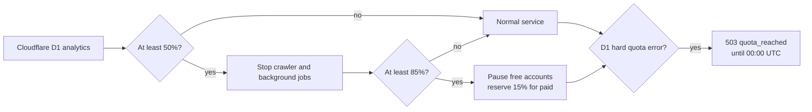

The proactive guard requires valid Cloudflare analytics credentials. If
analytics cannot be read, the app cannot estimate 50% or 85%; the reactive D1
error handler still converts a real daily-limit error into the friendly pause.

Daily D1 limits reset at 00:00 UTC. The UI converts that timestamp to the
reader's time zone.

## 13. Scheduled work

| Cron | Work |
|---|---|
| `17 * * * *` | Refresh due boards, purge expired operational rows, lifecycle/referral work, and at 06:00 UTC collect quota telemetry |
| `30 * * * *` | Enqueue paid scheduled market scans that are due |
| `* * * * *` | Continue queued market scans and recover stale processing scans |

Cron logic is selected in `worker/index.ts`. Keep total triggers within the
Cloudflare plan limit.

## 14. Email and notifications

- Resend sends verification and password-reset codes.
- Lifecycle mail is consent-gated and deduplicated.
- Scan-complete and low-credit messages are generated by code.
- Owner alerts summarize operations without including support-message bodies,
  tokens, or customer email addresses.
- Unsubscribe remains reachable during a capacity pause.

## 15. Testing boundaries

Committed automated tests use Vitest in a Node environment and run serially.
They cover deterministic engines, payment rules, capacity, scans, charge
idempotency, D1 batch guards, search paths, liveness, resume storage, and public
error handling.

The intensive browser E2E scripts used during the October 2026 release were
temporary and are not currently in the repository. The durable production
smoke checklist is therefore documented in `docs/handoff.md`; future work
should promote those scenarios into committed Playwright tests.

## 16. Architectural invariants

Future changes must preserve these rules:

1. No generated claim without user-provided provenance.
2. No credit charge without the corresponding durable result.
3. No duplicate charge when a request or webhook is replayed.
4. No opening expiry from an incomplete board read.
5. No secret in git, browser bundles, logs, support mail, or documentation.
6. No payment enablement without real seller details and verified live setup.
7. No destructive migration edited after production application.
8. No force-push to `main` merely to change commit authorship.
9. No database write on a passive page view unless the write is truly required.
10. No silent salary conversion or missing-pay guess.

