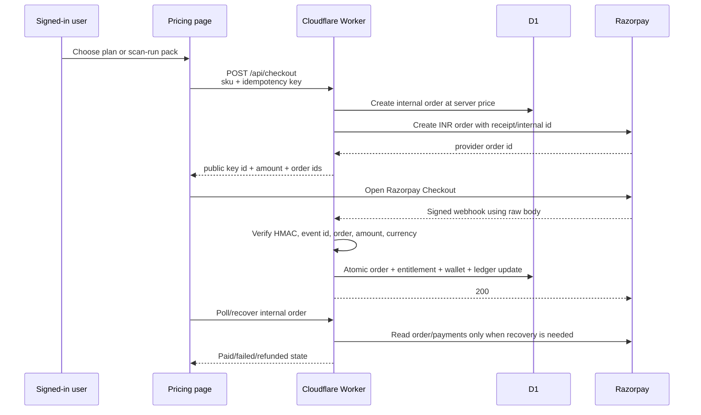

# Razorpay go-live runbook

> Status on 14 October 2026: Razorpay test mode is active. The test key id and
> key secret are in the gitignored local `.dev.vars`, together with a separate
> generated webhook secret and `PAYMENTS_ENABLED=true`. The Razorpay orders API
> accepted those test credentials and created an INR order. Local
> `/api/billing/status` returns `paymentsEnabled: true`.
>
> Production checkout stays closed. `wrangler.jsonc` still has
> `PAYMENTS_ENABLED: "false"`. Do not put the key secret or webhook secret in
> git. Before opening the live site, register the webhook in the Razorpay
> dashboard with the same webhook secret, set the three Worker secrets, add the
> real legal name and address, then follow section 6.
>
> The checkout code is already present. Local test mode is on through
> `.dev.vars`. The production switch is still `PAYMENTS_ENABLED: "false"` in
> `wrangler.jsonc`, and it stays there until every prerequisite below is complete.

This is the canonical activation guide for a future engineer or AI working from
another computer. Do not improvise a different payment flow.

## 1. Safety rules

1. Never enable payments merely because an account was submitted for review.
   The Razorpay dashboard must show live activation.
2. Never invent `LEGAL_NAME` or `LEGAL_ADDRESS`. Use the operator's real seller
   name and real postal address.
3. Never put a key secret or webhook secret in git, chat, screenshots, browser
   code, documentation, logs, or shell history.
4. Never grant credits from a browser callback or query string.
5. Never make a real purchase without first telling the operator the amount and
   receiving explicit approval.
6. Keep checkout closed if any inspection or smoke test is uncertain.
7. Turning checkout off is the first rollback. Do not immediately delete the
   webhook or secrets: an order created before closure may still need a captured
   payment or refund processed safely.

## 2. Existing architecture



Security and integrity already implemented:

- INR amount comes from `shared/plans.ts`, never from the browser.
- Checkout requires an authenticated user and a rate-limit check.
- Each attempt uses an idempotency key.
- Only `rzp_test_...` and `rzp_live_...` public key identifiers are accepted.
- The server secret and webhook secret must be different.
- Webhook HMAC is verified against the untouched raw request body before JSON
  parsing.
- Event identifiers are deduplicated.
- Provider order id, internal order id, amount, currency, and status are checked.
- Credits, entitlement, ledger entry, and applied marker are written atomically.
- Browser return alone cannot grant credits.
- Server recovery grants only after Razorpay reports a captured payment.
- A later capture cannot regrant a refunded order.
- Refund reversal cannot make any wallet negative.
- A cheaper later plan cannot downgrade the current plan or shorten expiry.
- Card number, buyer phone, and provider payload are not stored.

## 3. Code map

| Concern | File |
|---|---|
| Payment environment validation | `shared/payments.ts` |
| Plans, INR prices, grants | `shared/plans.ts`, `shared/commercial.ts` |
| Razorpay HTTP client | `worker/razorpay.ts` |
| Order, grant, refund, recovery logic | `worker/billing.ts` |
| Webhook and checkout routes | `worker/routes/billing.ts` |
| Browser checkout loader | `src/checkout.ts` |
| Pricing UI | `src/pages/PricingPage.tsx` |
| Contextual upgrade UI | `src/components/UpgradePrompt.tsx` |
| Return/recovery UI | `src/pages/CheckoutReturnPage.tsx` |
| Payment migrations | `migrations/0007_commercial_foundation.sql`, `migrations/0012_release_integrity.sql` |
| Payment tests | `tests/payments.test.ts`, `tests/checkout.test.ts` |
| Main operations guide | `docs/operations.md` |

The webhook endpoint is:

```text
POST /api/billing/razorpay/webhook
```

The recommended production webhook URL is the Worker directly:

```text
https://customjobseek.fkhambaty.workers.dev/api/billing/razorpay/webhook
```

Using the Worker directly avoids any intermediate proxy changing the raw body
whose exact bytes are covered by the Razorpay signature.

## 4. Prerequisites before touching production

All boxes must be true:

- [ ] Razorpay dashboard shows the account is verified and live payments are
      activated.
- [ ] The operator supplies the real legal seller name.
- [ ] The operator supplies the real postal address.
- [ ] Live API key id and key secret have been generated.
- [ ] A separate webhook secret has been generated; it is not the API secret.
- [ ] The production webhook exists at the exact URL above.
- [ ] The webhook subscribes to:
  - `payment.captured`
  - `payment.failed`
  - `order.paid`
  - `refund.processed`
- [ ] Remote D1 migrations are current.
- [ ] Typecheck, all tests, and the production build pass.
- [ ] The current Worker version id has been recorded for rollback.
- [ ] The operator understands the exact first live charge and approves it
      before the charge.

Check migrations and the current release:

```bash
npx wrangler d1 migrations list customjobseek --remote
npx wrangler deployments list
npm run typecheck
npm test
npm run build
```

If migrations are pending, apply them before enabling:

```bash
npm run db:migrate:remote
```

## 5. Test mode first

Use Razorpay Test Mode before live mode. Prefer local development or an
isolated staging Worker. Do not replace production live credentials with test
credentials merely to experiment.

Local `.dev.vars` must contain:

```text
PAYMENTS_ENABLED=true
RAZORPAY_KEY_ID=<test public key id>
RAZORPAY_KEY_SECRET=<test API secret>
RAZORPAY_WEBHOOK_SECRET=<separate test webhook secret>
LEGAL_NAME=<real test-visible operator name>
LEGAL_ADDRESS=<real test-visible operator address>
```

`.dev.vars` is ignored by git. Confirm that before adding values:

```bash
git check-ignore .dev.vars
git status --short
```

Test:

1. `/api/billing/status` returns `paymentsEnabled: true`.
2. Pricing opens Razorpay Checkout.
3. The amount shown by Razorpay exactly matches the selected INR price.
4. Closing Checkout leaves the order incomplete and grants nothing.
5. A failed test payment grants nothing.
6. A captured test payment grants the expected plan or scan runs once.
7. Replaying the same webhook grants nothing more.
8. The browser return page only polls/reconciles; it does not grant by itself.
9. A test refund removes only unused purchased credits and never produces a
   negative wallet.
10. Payment email and owner notice contain no card, secret, phone, or raw
    webhook data.

Razorpay test card details can change. Use the current official Razorpay Test
Mode documentation rather than copying old card numbers from chat.

## 6. Configure production while checkout remains closed

Keep this unchanged:

```json
"PAYMENTS_ENABLED": "false"
```

Set each production secret through Wrangler's hidden prompt:

```bash
npx wrangler secret put RAZORPAY_KEY_ID
npx wrangler secret put RAZORPAY_KEY_SECRET
npx wrangler secret put RAZORPAY_WEBHOOK_SECRET
```

Do not use `echo`, `printf`, command arguments, or a committed file for live
secret values.

Add the real operator values under `vars` in `wrangler.jsonc`:

```json
"LEGAL_NAME": "<real legal seller name>",
"LEGAL_ADDRESS": "<real postal address>"
```

These values are public legal-page content, not secrets. They must be true.

Deploy with checkout still closed:

```bash
npm run deploy
```

Verify:

```bash
curl -sS https://customjobseek.fkhambaty.workers.dev/api/billing/status
```

Expected before final enablement:

```json
{"paymentsEnabled":false,"operator":{"name":"...","address":"..."}}
```

The response must not expose either secret.

## 7. Final enablement

Only after the prerequisite checklist and test mode pass:

1. Ask the operator: “Razorpay is verified, all tests pass, and checkout is
   still closed. May I enable live checkout now?”
2. Wait for explicit approval.
3. Change exactly this line in `wrangler.jsonc`:

   ```diff
   - "PAYMENTS_ENABLED": "false"
   + "PAYMENTS_ENABLED": "true"
   ```

4. Run:

   ```bash
   npm run typecheck
   npm test
   npm run build
   npm run deploy
   ```

5. Confirm the public status:

   ```bash
   curl -sS https://customjobseek.fkhambaty.workers.dev/api/billing/status
   ```

   Expected:

   ```json
   {"paymentsEnabled":true,"operator":{"name":"...","address":"..."}}
   ```

6. Open Pricing signed out: prices and legal information must display, but
   purchase requires sign-in.
7. Open Pricing signed in: buttons should say `Buy ...`, not
   `Checkout closed`.
8. Do not yet assume credits work merely because the checkout window opens.

## 8. Controlled first live purchase

Before moving real money, tell the operator:

- the exact SKU,
- the exact INR charge,
- which test account will buy it,
- that a refund will be tested if the operator agrees.

The smallest current live SKU is the five-scan add-on at ₹149, but do not choose
or buy it without explicit approval.

During the controlled purchase:

1. Use a dedicated verified account.
2. Record the account's three wallet balances.
3. Start one checkout and finish it once.
4. Confirm the return page reaches paid.
5. Confirm the selected credits/runs appear exactly once.
6. Refresh and sign in again; balances must persist.
7. Confirm the payment email arrives.
8. Confirm the owner gets a scrubbed operational note.
9. Confirm no card number or raw provider body exists in logs or D1.

Safe database checks should use the internal order id, not a customer's email:

```sql
SELECT id, sku, amount_inr, currency, status, provider_order_id
FROM orders
WHERE id = '<internal-order-id>';

SELECT order_id, sku, eval_credits, resume_credits, scan_runs,
       applied, refund_status
FROM entitlements
WHERE order_id = '<internal-order-id>';

SELECT kind, eval_delta, resume_delta, runs_delta, note
FROM credit_ledger
WHERE note LIKE '%' || '<internal-order-id>' || '%'
   OR note LIKE 'paid %'
ORDER BY created_at DESC
LIMIT 10;
```

Expected:

- order status is `paid`,
- currency is `INR`,
- amount matches `shared/plans.ts`,
- one entitlement exists and `applied = 1`,
- one grant ledger line exists,
- repeated webhook delivery does not add a second grant.

## 9. Controlled refund

Only refund if the operator explicitly approved that part of the live test.

1. Initiate the refund from Razorpay.
2. Wait for `refund.processed`.
3. Confirm the internal order becomes `refunded`.
4. Confirm entitlement refund status becomes `partial` or `full`.
5. Confirm only credits still present in the pooled wallet are removed.
6. Confirm no balance is negative.
7. Replay/recovery must not add the refunded credits again.
8. Confirm the refund email arrives.

The pooled-wallet limitation is intentional: after credits from multiple
purchases are mixed and spent, the system cannot know which exact purchase's
credit was consumed. It therefore reverses only the unused balance, never more
than the purchase granted and never below zero.

## 10. Emergency close and rollback

If checkout, webhooks, wallet grants, legal text, or provider responses look
wrong:

1. Immediately set:

   ```json
   "PAYMENTS_ENABLED": "false"
   ```

2. Deploy:

   ```bash
   npm run deploy
   ```

3. Confirm `/api/billing/status` returns `paymentsEnabled: false`.
4. Confirm pricing buttons say `Checkout closed`.
5. Leave the webhook and credentials active while investigating orders that
   were already created. The code intentionally accepts a valid webhook while
   new checkout is closed.
6. Record affected internal order ids.
7. Do not manually edit wallets without reconciling the order, entitlement, and
   ledger together.
8. If the code release itself is bad, use the Worker rollback procedure in
   `docs/handoff.md`.

Closing checkout prevents new orders. It does not erase an existing provider
order, reverse a charge, or replace a refund.

## 11. Failure guide

| Symptom | Likely cause | Action |
|---|---|---|
| Status says disabled | `PAYMENTS_ENABLED` is not exact lowercase `"true"` | Leave closed until ready; then correct and deploy |
| Status stays disabled after flag | Missing or malformed key/secret | Inspect secret names; never print values |
| `501 Payments are not ready` | Flag/credentials incomplete | Keep closed and fix configuration |
| Checkout opens with wrong amount | Code/config mismatch | Close immediately; do not pay |
| Webhook gets 400 invalid signature | Wrong webhook secret or changed raw body | Check direct Worker URL and dashboard secret |
| Payment captured but credits absent | Webhook delayed/failed | Use signed webhook logs and authenticated recovery; never grant manually from browser data |
| Duplicate events arrive | Normal provider retry | Idempotency should make later deliveries no-ops |
| Refund does not remove all original credits | Some purchased credits were already spent | Expected pooled-wallet behavior; never make balance negative |
| A refunded order appears captured later | Out-of-order provider event | Code blocks regrant; inspect owner alert |

## 12. Completion record

When live activation succeeds, update this section in the same commit:

- activation date and timezone,
- production Worker version id,
- webhook URL used,
- event names configured,
- first live SKU and amount,
- whether refund was exercised,
- test account deleted or retained,
- issue [#6](https://github.com/fkhambaty/customjobseek/issues/6)
  closed with a short result and no secrets.

Do not record key values, signatures, card details, customer email, phone,
addresses, or raw provider payloads.

